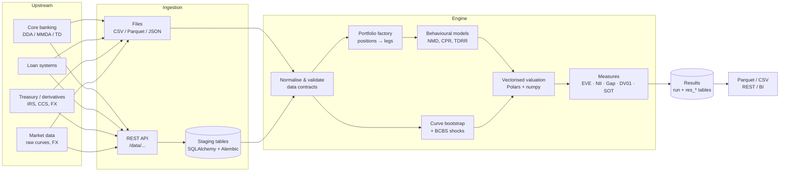

# IRRBB Engine

A Python engine to measure **Interest Rate Risk in the Banking Book** for a
multi-currency banking book booked in the US. It accepts contract terms or
pre-computed cash flows from upstream systems, takes raw curves from market
data providers, and produces in-house:

| Output | Description |
|---|---|
| **MtM / PV** | Present value of every position and leg, under the base and every shocked scenario |
| **ΔEVE (full revaluation)** | Change in economic value with re-projected floating coupons and scenario-dependent behaviour |
| **ΔEVE (BCBS 368 standardised)** | Repricing cash flows slotted into 19 time buckets and discounted at bucket mid-points |
| **NII / ΔNII** | 12-month (configurable) net interest income under a constant balance sheet, with deposit betas |
| **Repricing gap** | Rate-sensitive assets and liabilities per currency and time bucket |
| **PV01 / key-rate DV01** | Position-level parallel PV01 and per-currency key-rate DV01 |
| **Limits** | Board / ALCO limits vs base NII, base EVE and Tier 1, with early warnings |
| **Outlier tests** | BCBS 368 test, available but off for the US bank profile |
| **Reconciliation** | Engine vs source-system cash flows, position by position |
| **Data quality** | Coverage, quote plausibility, curve shape, day-over-day moves |

The engine is set up for a **US full-licence bank** measured under US
supervisory expectations against its own capital. See
[Regulatory set-up](guides/regulatory-setup.md).

## Supported products

DDA, MMDA, savings, term deposits, fixed/floating and amortising loans,
mortgages, bonds, interest rate swaps, cross-currency swaps, FX forwards, NDFs
and FX swaps. Credit cards are modelled as behavioural run-off assets (see
[Roadmap](roadmap.md)).

## Architecture

### Design principles

* **Everything is a leg.** Each product decomposes into legs
  ([`Leg`][irrbb.instruments.leg.Leg]); one generic, well-tested cash-flow
  generator serves every product.
* **Skeletons once, scenarios many.** Legs emit scenario-independent
  *skeletons* that are stacked into Polars frames once. Each scenario then
  costs only vectorised forward projection and discounting.
* **Shocks are functions of time.** Shocked curves are exact at every maturity,
  not only at the pillars, and post-shock floors follow EBA conventions.
* **Pluggable inputs.** Files, the staging database, or any custom
  [`DataSource`][irrbb.data.sources.DataSource].
* **Auditable outputs.** Every run stores its configuration, shocked curves,
  cash flows and every intermediate table.

## Next steps

* [Getting started](getting-started.md): install, generate sample data, run.
* [Data contracts](guides/data-contracts.md): what upstream systems must send.
* [Methodology](methodology/eve.md): how each number is computed.
